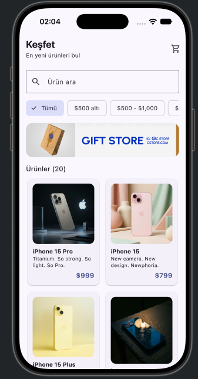
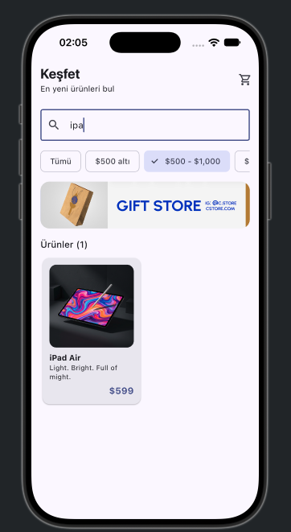
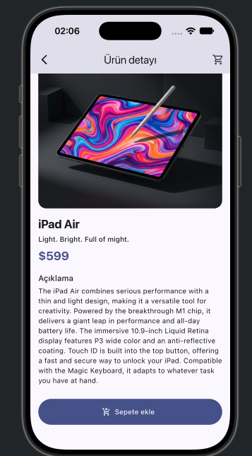
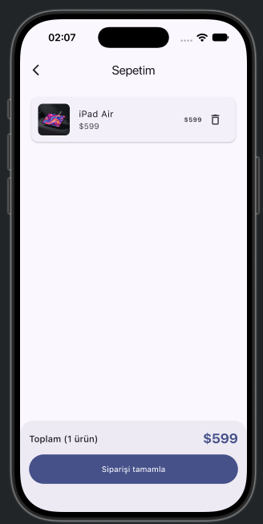
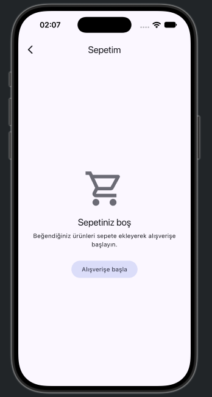

# Mini Katalog

## Proje adı

**Mini Katalog**: Flutter ile geliştirilmiş basit bir ürün kataloğu ve sepet uygulaması.

## Kısa açıklama

Uygulama, yerel bir JSON dosyasından (API simülasyonu) ürünleri okur ve bunları grid görünümünde listeler.
Kullanıcı ürünleri isme göre arayabilir ve fiyat aralığına göre filtreleyebilir. Bir ürüne dokunduğunda detay
sayfası açılır ve ürün sepete eklenebilir. Sepette ürünler listelenir, toplam tutar hesaplanır ve sipariş
simülasyon olarak tamamlanır. Uygulamada Flutter SDK dışında hiçbir paket kullanılmamıştır.

TNC Group Flutter eğitimi, "Mobil Uygulama Geliştirme; Android / iOS" bitirme projesi.

## Kullanılan Flutter sürümü

```
Flutter 3.47.7 • channel stable • https://github.com/flutter/flutter.git
Framework • revision abaf9c5237 (8 days ago) • 2026-10-08 09:51:21 -0700
Engine • hash d8a2d6c768c334d53e16277f837970ffa1e2de81 (revision deb287481e) (9 days ago) • 2026-10-07 17:09:12.000Z
Tools • Dart 3.13.5 • DevTools 2.60.0
```

## Çalıştırma adımları

1. Depoyu klonlayın:
   ```bash
   git clone https://github.com/ilker-ekin/mini-catalog-flutter.git
   cd mini-catalog-flutter
   ```
2. Bağımlılıkları yükleyin:
   ```bash
   flutter pub get
   ```
3. Bir emülatör / simülatör başlatın:
   - **iOS:** `open -a Simulator` (Xcode gerekir)
   - **Android:** Android Studio → Device Manager üzerinden bir emülatör açın
4. Uygulamayı çalıştırın:
   ```bash
   flutter run
   ```

Testler için: `flutter test`

## Ekran görüntüleri

| Ana sayfa | Arama ve filtre | Ürün detayı | Sepet | Boş sepet |
|---|---|---|---|---|
|  |  |  |  |  |

## Özellikler

| Konu | Nerede |
|---|---|
| Stateless widget | `ProductCard`, `PromoBanner`, `CartItemTile`, `EmptyCart`, `ProductDetailScreen`, `CartScreen` |
| Stateful widget | `HomeScreen` (arama metni ve seçili filtre) |
| Text, Container, Row, Column, Padding, Expanded, Align | `product_card.dart`, `cart_screen.dart`, `promo_banner.dart` |
| Card, ListTile, butonlar | `cart_item_tile.dart`, `product_detail_screen.dart` (özellikler, "Sepete ekle"), `cart_screen.dart` |
| Named Routes + `onGenerateRoute` + `MaterialPageRoute` | `main.dart` (`/` ve `/detail`) |
| Route Arguments | `/detail` rotasına `Product` nesnesi argüman olarak gönderilir |
| `Navigator.push` / `Navigator.pop` | Sepet `Navigator.push(MaterialPageRoute(...))` ile açılır; boş sepetteki "Alışverişe başla" `Navigator.pop` ile döner |
| Model sınıfı, `fromJson` / `toJson` | `lib/models/product.dart` |
| JSON simülasyonu | `assets/data/products.json`, `rootBundle.loadString` + `jsonDecode` (`product_service.dart`) |
| GridView | Ana sayfadaki ürün kartları (`GridView.builder`) |
| ListView.builder | Sepetteki ürün listesi |
| Image.asset | Banner (`assets/images/banner.png`) ve görsel yüklenemezse gösterilen placeholder |
| Arama ve filtreleme | İsme göre arama (büyük/küçük harf duyarsız) + fiyat aralığı `ChoiceChip` filtreleri, ikisi birlikte çalışır |
| Sepet durumu (simülasyon) | `CartController extends ChangeNotifier` + `ListenableBuilder`; ekleme, kaldırma, toplam, sipariş sonrası temizleme |
| Tema | `ThemeData(useMaterial3: true, colorSchemeSeed: Colors.indigo)` |

## Proje yapısı

```
lib/
  main.dart                         # MaterialApp, tema, onGenerateRoute, CartController
  models/product.dart               # Product modeli (fromJson / toJson), fiyat formatlama
  services/product_service.dart     # assets/data/products.json dosyasını okur
  controllers/cart_controller.dart  # Sepet durumu (ChangeNotifier)
  screens/
    home_screen.dart                # Ana sayfa: arama, filtre, banner, ürün grid'i
    product_detail_screen.dart      # Ürün detayı
    cart_screen.dart                # Sepet ve boş sepet durumu
  widgets/
    product_card.dart, product_image.dart, promo_banner.dart,
    cart_button.dart, cart_item_tile.dart, empty_cart.dart
assets/
  data/products.json                # Ürün verisi (API simülasyonu)
  images/banner.png, placeholder.png
test/widget_test.dart               # Model, sepet ve ekran akışı testleri
docs/screenshots/                   # Ekran görüntüleri
```

## Veri kaynağı

Ürün verisi ve banner, eğitmenin paylaştığı demo kaynaklardan bir kez indirilip projeye eklenmiştir:

- Ürünler: `https://wantapi.com/products.php` → `assets/data/products.json`
- Banner: `https://wantapi.com/assets/banner.png` → `assets/images/banner.png`

Uygulama çalışırken ürün verisi için ağ isteği yapılmaz; veri yerel JSON dosyasından okunur. Ürün görselleri
`Image.network` ile yüklenir, yüklenemezse yerel placeholder görseli gösterilir. Veri yalnızca eğitim amaçlı
örnek veridir.
